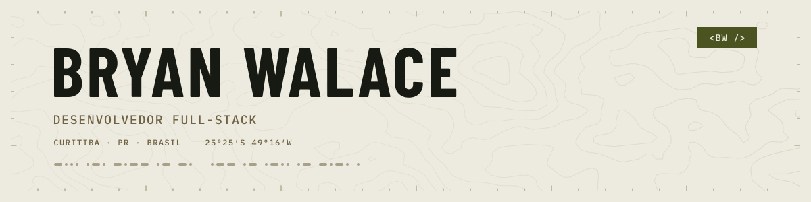
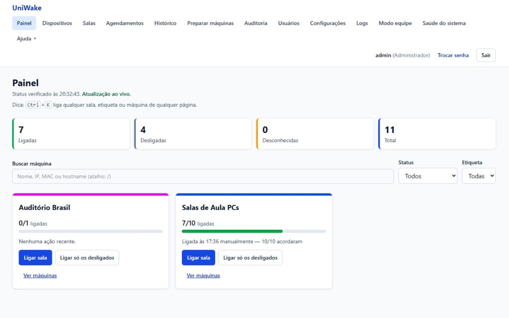
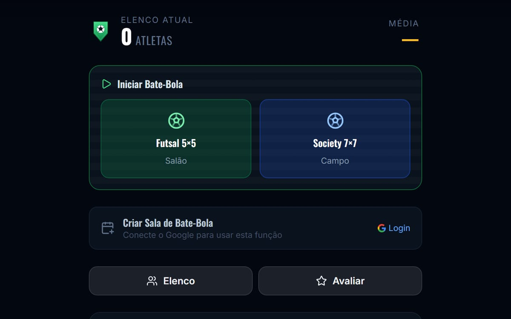
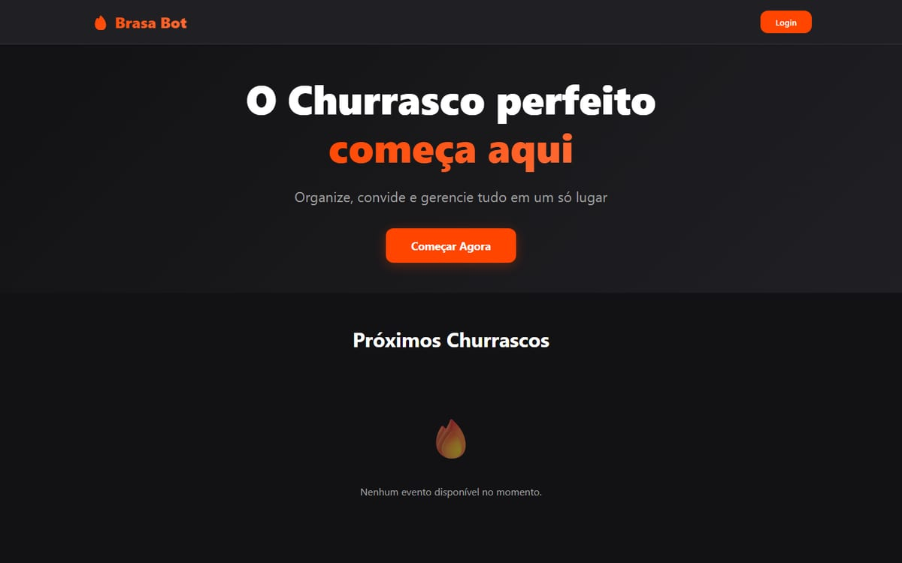
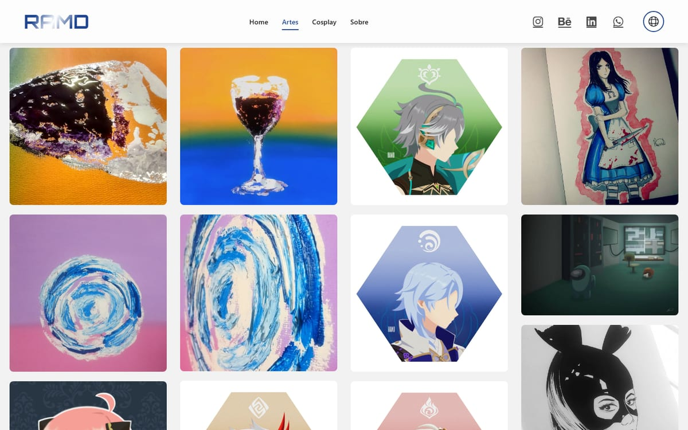

<picture>
  <source media="(prefers-color-scheme: dark)" srcset="assets/banner-dark.svg">
  <source media="(prefers-color-scheme: light)" srcset="assets/banner-light.svg">
  
</picture>

Desenvolvedor full-stack em Curitiba. Construo aplicações web com React, Next.js, TypeScript e Node.js, com Firebase e Cloudflare na infraestrutura. Trabalho no suporte de TI do Instituto Pan Americano, onde criei o UniWake, que a equipe usa no dia a dia para ligar e agendar os computadores dos laboratórios. Formado em Análise e Desenvolvimento de Sistemas pela Universidade Positivo.

Aberto a vagas de desenvolvedor full-stack (remoto ou híbrido em Curitiba) e a projetos freelance.

[bryanwalace.dev](https://bryanwalace.dev) · [LinkedIn](https://www.linkedin.com/in/bryan-walace/) · [bryanwalace@gmail.com](mailto:bryanwalace@gmail.com)

## 01 · Projetos

<table>
  <tr>
    <td width="50%" valign="top">
      
        
      <b><a href="https://github.com/BryanWalace/UniWake">UniWake</a></b>
       
      Liga, desliga e agenda pelo navegador os computadores dos laboratórios de uma instituição de ensino. Roda como serviço do Windows e sincroniza os PCs da equipe de TI pela rede local.
       
      TypeScript · Node.js · Fastify · React · TanStack Query · SQLite · Vitest · Playwright · GitHub Actions
       
      <a href="https://github.com/BryanWalace/UniWake">Código</a> · <a href="https://github.com/BryanWalace/UniWake/releases">Releases</a>
    </td>
    <td width="50%" valign="top">
      
        
      <b><a href="https://matchmakerfc.com.br">MatchMaker FC</a></b>
       
      Sorteia times equilibrados para peladas e cria salas com link para os jogadores confirmarem presença sem instalar nada.
       
      React · TypeScript · Vite · Zustand · Tailwind CSS · Firebase · Vitest · PWA
       
      <a href="https://matchmakerfc.com.br">Demo</a> · código privado
    </td>
  </tr>
  <tr>
    <td width="50%" valign="top">
      
        
      <b><a href="https://github.com/BryanWalace/brasa-bot">Brasa Bot</a></b>
       
      Organiza churrascos entre amigos com bot de Discord, painel web e pagamentos via Pix. O login com Discord passa por um Cloudflare Worker que emite o token do Firebase.
       
      Next.js · React · Cloudflare Workers · Firebase · Discord Interactions · JWT
       
      <a href="https://github.com/BryanWalace/brasa-bot">Código</a>
    </td>
    <td width="50%" valign="top">
      
        
      <b><a href="https://github.com/BryanWalace/art-portfolio">Portfólio de Arte RAMD</a></b>
       
      Portfólio interativo de arte digital e cosplay, com galeria, animações e três idiomas.
       
      React · Vite · GSAP · Framer Motion · Swiper
       
      <a href="https://github.com/BryanWalace/art-portfolio">Código</a> · <a href="https://ramd-seven.vercel.app">Demo</a>
    </td>
  </tr>
</table>

Outros: [Bot de Vagas](https://github.com/BryanWalace/bot-discord-vagas), bot de Discord que coleta vagas por web scraping e publica no horário configurado · [Website of Architects](https://github.com/BryanWalace/website-of-architects), layout do Figma recriado com React Router ([demo](https://website-of-architects-lemon.vercel.app)).

## 02 · Stack

| Área | Tecnologias |
|---|---|
| Linguagens |   |
| Front-end |      |
| Back-end |    |
| Dados |   |
| Infra e entrega |    |
| Testes |   |
| Integrações e automação |     |
| APIs de IA |    |
| Em estudo |  |

## 03 · Trajetória

- **Técnico de Suporte ao Usuário** · Instituto Pan Americano · atual
- **Desenvolvedor front-end freelancer** · BwDev · 2024–atual
- **Estagiário de TI** · Defensoria Pública do Estado do Paraná · 2023–2024
- **Soldado** · Exército Brasileiro · 2019–2020
- Análise e Desenvolvimento de Sistemas · Universidade Positivo · 2023–2025
